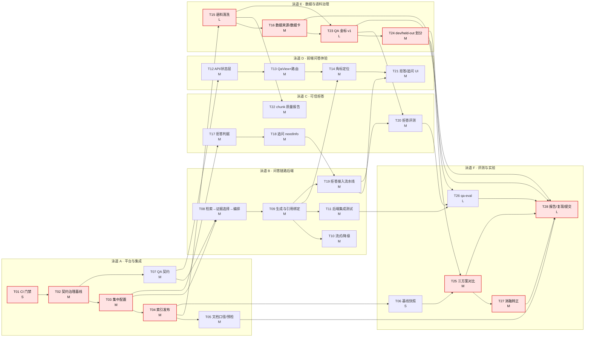

# 任务拓扑（Task Topology）· AI_RAG「沥知问答」

> **用途**：把课程设计剩余工作切成 **28 个可独立开 Issue、可独立发 PR 的任务**，给出依赖、写域、验收标准与合入规则。本文件是团队排期与 PR 评审的唯一依据。
> **基线**：**M0 基线提交**（`main` 初始 commit，作者 A）。M0 已交付的清单见 **§0.5**——本表每个任务都标了「现状 / 本任务剩余工作」，**已交付项只做加固与扩展，不重复实现**。
> **上游依据**：`.analysis/course-design/00-课程设计选题匹配与提交清单.md`（P0/P1/P2）、`A-rag-audit.md §5`（代码落点）、`B-exp-audit.md`（实测数字）、`C-delivery-audit.md`（交付缺口）。
> **配套文件**：`docs/plan/tasks.json`（机器可读，字段与本文件一一对应，lead 用它批量建 Issue）、`docs/团队分工.md`（成员 → 模块 → 答辩技术点）。
> **维护**：本文件与 `tasks.json` 由 A 维护；任务内容变更需在 Issue 中说明并同步更新两份文件，**禁止只改一处**。

---

## 0. 一页速览

### 0.1 四个里程碑

| 里程碑（Issue milestone 值） | 出口（累计工作日，按 §2.2 排程推算） | 目标 | 出口条件（Exit Criteria） | 任务 |
|---|---|---|---|---|
| **S0-迁移收口** | **D6.5** | 迁移后的仓库具备并行开发条件：CI 能拦、契约有真相源、配置集中、索引可复现、文档口径不打架 | `verify` job 全绿且已设为必需检查；`build-index --check` 通过；README 命令可原样复制；基线快照入库 | T01–T06 |
| **S1-QA主链路** | **D8.5** | `/api/v1/qa` 打通「问题 → 检索 → 证据选择 → 生成 → `[n]` 引用绑定」，前端能问到答案并跳原文 | 一个问题能返回答案 + ≥3 条带原文的证据；点 `[n]` 能定位；语料已剔除域外、索引已重建 | T07–T16 |
| **S2-可信拒答与质量** | **D12** | 拒答/追问落地并被评测；QA 金标集与 held-out 划分就位；chunk 质量可量化 | 「今天天气」被拒、「该用什么沥青」被追问、空库不崩；拒答矩阵有数字；24 条金标可用 | T17–T24 |
| **S3-实验与提交** | **D17** | 三方案对比 + 消融 + 问答指标全部可复跑，报告与提交包收口 | 四条检索命令出四行结果；qa-eval 出「方案 × 指标」表；6 章报告 + 复现验证记录完成 | T25–T28 |

> **里程碑是 Issue 分组标签，不是硬门禁**：S0 的后半段（T04/T05）与 S1 的前半段（T07/T08）在日历上重叠——A 一边发索引一边已经在写 QA 契约。真正卡顺序的是 §3.3 的四条冻结规则（索引冻结窗 / 语料冻结窗 / 契约冻结 / S0 串行窗），不是 milestone 本身。

> 口径：规模 S = 0.5 人日、M = 1.5 人日、L = 2 人日 → **总量 ≈ 42 人日**（含测试/文档/评测产物）；**关键路径 17 人日 → 日历 ≈ 17 个工作日**（约 3.5 周，见 §2.2）。⚠️ 这比 `00-课程设计选题匹配与提交清单.md` 的「最小可提交 ≈ 8–9 人日」大得多：那是最低完成度，本表按课程 DoD 全量口径（每任务自带测试/文档/评测产物）。若课程窗口只有 2 周，按 §7 裁剪顺序砍到「最小可提交集」，日历 ≈ 15–16 个工作日；再要缩短必须并行化 E 的数据链（见 §2.2 压缩手段）。S0 的主体由 A 独占（T01–T05）；F 只在 T04 完成后插入 0.5 天的 T06 基线快照；其余 4 人在 S0 期间只做「读代码 + 写设计 + 提 Issue」，不并写代码——这是唯一一个刻意串行的阶段。

### 0.2 团队角色表（A–F 为代称，禁止真实身份）

| 成员 | 角色 | 主目录 / 文件 | 任务 | 基线状态 |
|---|---|---|---|---|
| **A** | 平台与集成 | `packages/contracts/src/`、`apps/server/src/{app,config}.ts`、`scripts/build-index.ts`、`scripts/preflight.ts`、`config/`、`.github/` | T01 T02 T03 T04 T05 T07 | **已交付 M0 基线（§0.5）**；后续只做平台类任务，同时是唯一合入人 |
| **B** | 问答链路后端 | `apps/server/src/routes/qa.ts`、`apps/server/src/qa/{retrieve,select,generate,stream,index}.ts`、`prompts/qa.md` | T08 T09 T10 T11 T19 | 骨架已就位（`routes/qa.ts` 501 + `qa.test.ts` 契约守卫），检索与生成待实现 |
| **C** | 可信拒答策略 | **只写** `apps/server/src/qa/{refusal,clarify}.ts`、`scripts/{refusal-eval,chunk-quality-report}.ts` + 自己的测试 | T17 T18 T20 T22 | 契约枚举 `QaRefusalReason` 已定义，判据实现为零 |
| **D** | 前端问答体验 | `apps/web/src/views/QaView.vue`、`apps/web/src/components/{CitationBadge,QaAnswer,RefusalNotice,NeedInfoForm}.vue`、`apps/web/src/{api/qa,stores/qa}.ts` | T12 T13 T14 T21 | 无问答视图（推荐视图可复用证据卡） |
| **E** | 数据与语料治理 | `data/corpus/**`、`data/golden/qa.json`、`scripts/validate-corpus.ts` | T15 T16 T23 T24 | 表格语料约 12% 域外；无 QA 金标 |
| **F** | 评测与实验 | `scripts/{golden-eval,qa-eval,ablation-*}.ts`、`docs/experiments/`、`docs/报告-完整版.md` | T06 T25 T26 T27 T28 | 三方案少 `--vector`/`--rerank`；无 qa 指标与实验产物入库 |

> 归属细节、答辩技术点见 `docs/团队分工.md`。CODEOWNERS 占位句柄 `@OWNER-A` … `@OWNER-F` 与上表一一对应。

### 0.3 PR 规范（硬规则，违反即打回）

| 项 | 规则 | 校验方式 |
|---|---|---|
| 分支名 | `feat/T07-qa-view`、`fix/T26-qa-eval-null`、`docs/T05-readme`（`类型/任务ID-短横线描述`） | PR 检查清单人工确认 |
| PR 标题 | `[T07] 前端问答视图`（**任务 ID 必填**，与 `tasks.json` 的 `id` 一致） | A 合入前核对 |
| 关联 Issue | PR 正文写 `Closes #<issue>`；Issue 由 `tasks.json` 生成，title 以 `[T07]` 开头 | GitHub 自动关联 |
| diff 规模 | **单 PR ≤ 400 行**（不含锁文件、生成数据、快照）；超出即拆 | 人工 + `git diff --stat` |
| 必过门禁 | `pnpm test` exit 0（passed 不低于 M0 基线 **334**）**且** `pnpm typecheck` exit 0（5 包） | CI `verify` job 全绿 |
| 评审 | **至少 1 名 reviewer**；涉及共享文件必须 A 评审；作者不得自审自合 | GitHub review |
| 合入 | **只有 A 合入**（squash merge，标题即 PR 标题）；作者无权直接 push main | 分支保护 |
| 数据/实验 | 涉及检索、生成、拒答、语料的改动，必须附 `docs/experiments/*.json` 或语料变更前后计数 | PR 检查清单 |

### 0.4 数字口径（全仓唯一真相源，grep 门禁用）

| 事实 | 正确口径 | 禁止再出现的旧口径 |
|---|---|---|
| 索引块数 | **11,143**（lancedb/manifest）；`app.db` 11,087 仅作历史对照 | 241、11,087（当唯一值） |
| 检索金标准 | **38 条**；达标 38/38，**mean recall@5 = 0.9187**；T24 之后评测报告按 **dev 28 / held-out 10** 分列（held-out 单独报告，不参与调参） | 「金标准 20 条」「38/38 = 100%」「dev 用 38 条」 |
| 三方案 | BM25 35/38（0.8574）、纯向量 36/38（0.8818）、混合 38/38（0.9187），口径：lancedb + topK×3 去重后取前 5 | 无 |
| 单测 | `pnpm test` **334 passed / 3 skipped**（contracts 10 / embedding 14 / retrieval 17 / server 76 / web 176 / scripts 41 + 3 skip） | M0 之前的旧 passed 数（3 位数，已作废） |
| 端到端时延 | 必须**分项**给（检索/重排/生成/总），并标注是否降级模式 | 「端到端 11–18s」单值 |

### 0.5 M0 基线已交付清单（T01–T08 只加固/扩展，不重复实现）

| # | 已交付项 | 落点 | 本表对应任务的剩余工作 |
|---|---|---|---|
| ① | pnpm workspace 包名统一为 `@ai-rag/*`，仓库名 `AI_RAG` | `pnpm-workspace.yaml`、各 `package.json` | T02 只做契约治理，不动包名 |
| ② | `.gitignore` / `.env.example` / `.npmrc`（onnxruntime CUDA skip） | 仓库根 | T05 补变量说明；`data/index/**`、`data/db/**`、hf-cache 保持忽略 |
| ③ | 全新 `README.md` + `docs/{选题与项目边界,数据来源与清洗说明,复现指南,团队分工}.md` + `NOTICE.md` + `LICENSE` + `docs/archive/` 归档 | `README.md`、`docs/`、`NOTICE.md`、`LICENSE` | T05 修数字/命令；T16 补数据卡；T28 收口报告 |
| ④ | CI 工作流 `ci.yml`（`install → pnpm -r typecheck → pnpm test`，3 步，无 lint，项目未配 eslint） | `.github/workflows/ci.yml` | T01 加固：分支保护 + 生效证据 + 耗时/lint 决策 |
| ⑤ | 问答骨架：5 个契约（`QaRequest/QaCitation/QaResponse/QaStatus/QaRefusalReason`）+ `routes/qa.ts`（501，含 400 校验）+ `qa/README.md` 边界 + `prompts/qa.md` + `apps/server/test/qa.test.ts` | `packages/contracts/src/schemas.ts:435-501`、`apps/server/src/routes/qa.ts`、`apps/server/src/qa/README.md`、`apps/server/test/qa.test.ts` | T07 补接缝 schema + openapi；T08 把 501 换成真实检索 |
| ⑥ | 品牌统一为「沥知问答」 | `apps/server/src/app.ts`（OpenAPI title）、`apps/web/src/App.vue` 等 | T21 收口前端文案，不再做品牌迁移 |
| ⑦ | 质量门禁可用：`pnpm test` **334 passed / 3 skipped**、`pnpm typecheck` 5 包全过 | — | 所有任务沿用该基线，passed 只增不减 |

> 上述已交付项在 T01–T08 中**只做加固/扩展，不重复实现**；若某任务的验收与本清单冲突，以清单为准并当场改任务卡（同步 md 与 `tasks.json` 两处）。

---

## 1. 任务清单（28 个）

**字段说明**：`写域` = 该任务允许修改的文件/目录（超出即越界，见 §3）；`依赖` = 必须先行合入的任务 ID（`—` 表示无）；`规模` = S（≤0.5 人日）/ M（1–1.5 人日）/ L（2 人日，允许 1–2 个 PR）。
**验收标准**的判定原则：能贴命令、能贴数字、能被第二个人重跑。

### 1.1 S0-迁移收口（T01–T06）

| ID | 标题 | 负责人 | 里程碑 | 依赖 | 写域（文件/目录） | 交付物 | 验收标准（可验证） | 规模 |
|---|---|---|---|---|---|---|---|---|
| **T01** | CI 门禁加固与分支保护 | A | S0-迁移收口 | — | `.github/workflows/ci.yml`（**在现有 3 步上加固，不新建**）、`docs/plan/ci-evidence.md`（新建） | 分支保护与必需检查生效证据、PR 模板与 CODEOWNERS 生效证据、CI 缓存与耗时记录、lint 决策记录（配 / 不配 + 理由） | ① 现有 `install → pnpm -r typecheck → pnpm test` 在 PR 上全绿，本地 `pnpm test` 为 **334 passed**、`pnpm typecheck` 5 包全过；② main 分支保护要求该 check 通过 + ≥1 review，Settings 截图入 `docs/plan/ci-evidence.md`；③ CI **冷启动 < 6 min**，贴出冷/热两次耗时与 pnpm cache 命中；④ lint 决策记录归档：引入则加一步且对现有代码 exit 0，不引入则写明「项目未配 eslint」的理由 | S |
| **T02** | 契约治理基线（provenance 字段与 JSON Schema 导出） | A | S0-迁移收口 | T01 | `packages/contracts/src/schemas.ts`、`packages/contracts/src/json-schema.ts`、`packages/contracts/test/contracts.test.ts`、`docs/接口契约.md`（新建） | provenance 7 字段与 6 类 docType 的可读登记、对外响应体 JSON Schema 导出（≥ 8 个）、契约测试补齐 | ① `pnpm --filter @ai-rag/contracts test` exit 0，契约用例较 M0 基线（10 例）**+8**；② 导出 ≥ 8 个响应体且与 `/openapi` component 名一致（测试断言）；③ `docs/接口契约.md` 给出「schema ↔ 路由 ↔ 前端消费点」三列表；④ `git diff --stat` 不含 `apps/` 运行时文件（不改行为） | M |
| **T03** | 集中配置与参数登记 | A | S0-迁移收口 | T02 | `config/params.json`（新建）、`apps/server/src/config.ts`、`scripts/test/params.test.ts`、`docs/参数说明.md` | 参数单一来源（RRF k=60、HYBRID_WEIGHTS、MMR、证据配额 3 槽、11 项阈值、`qa.minHits/minScore/minCoverage` 预留位）、加载器、参数说明 | ① `config/params.json` 覆盖 ≥ 15 个参数，每项含 `default/range/owner/desc` 四字段；② 加载优先级 `env > params.json > 内置默认`，非法值启动即报错，配置测试 ≥ 6 例；③ `docs/参数说明.md` 与 params 键一一对应（CI 断言脚本 `scripts/test/params.test.ts` 内比对）；④ `pnpm --filter @ai-rag/server test` 不回归 | M |
| **T04** | 索引构建与发布、双后端统一 | A | S0-迁移收口 | T03 | `scripts/build-index.ts`、`apps/server/src/config.ts`、`docs/experiments/index-fingerprint.json`（新建）、`docs/索引构建与发布.md`（新建） | `--check` 自检模式；服务端与评测脚本指向同一个 sqlite 库；**索引产物全部不入库**，改为提交可核对的指纹文件 | ① `pnpm exec tsx scripts/build-index.ts --check` exit 0，打印 `count=11143 / model=multilingual-e5-small / dim=384`；② `grep -r "sqlite.db" --include=*.ts` 显示库路径只由 `config.ts` 一处派生；③ `docs/experiments/index-fingerprint.json` 含 `count / model / dim / manifestHash / pipelineRev / command / generatedAt` 七字段，由 `--check` 生成；④ 全量 38 条回归：达标 38/38 且 mean ≥ 0.9187（±0.001）；⑤ **不修改 `.gitignore`**、不提交 `data/index/**` 与 `data/db/**` 二进制产物 | M |
| **T05** | 文档口径收口与演示预检脚本 | A | S0-迁移收口 | T04 | `README.md`、`docs/复现指南.md`（新建）、`scripts/preflight.ts`（新建）、`.env.example`、`docs/demo-script.md`（现状在 `docs/archive/`） | README 6 处硬故障修正（裸 `tsx`、20 条、11,087、13s、7 篇、端口/`E2E_BASE_URL`）、预检脚本、复现指南单一入口 | ① README 内每条命令在干净环境原样执行，PR 里逐条贴输出片段；② 全仓 grep 不再出现 `11,087`、`金标准 20 条`、`100%`（§0.4 三处旧口径）；③ `pnpm exec tsx scripts/preflight.ts` 输出端口/`/health`/LLM 探活/降级 4 项，LLM 402 时打印「余额不足」且 exit 0；④ `docs/复现指南.md` 含 ≥ 12 条命令 + 端口策略（3011/5175）+ 按后端/模型的矩阵命令 | M |
| **T06** | 评测基线快照（迁移后复位点） | F | S0-迁移收口 | T04 | `scripts/experiments/snapshot-baseline.ts`（新建）、`docs/experiments/baseline-<sha>.json`（新建）、`docs/experiments/README.md`（新建） | 可对比的复位点：两方案指标（纯向量待 T25）、测试数、索引 manifest hash、环境行（Node/pnpm/CPU/模型） | ① JSON 含 `gitCommit / indexManifestHash / env / commands / metrics` 五段；② 命令实测复现 00 号审计数字（BM25 35/38 0.8574、混合 38/38 0.9187）；③ 同机二次运行仅时间戳不同（`diff` 断言）；④ `docs/experiments/README.md` 为每份 JSON 标注生成命令 | S |

### 1.2 S1-QA主链路（T07–T16）

| ID | 标题 | 负责人 | 里程碑 | 依赖 | 写域（文件/目录） | 交付物 | 验收标准（可验证） | 规模 |
|---|---|---|---|---|---|---|---|---|
| **T07** | QA 接缝契约（RefusalDecision / NeedInfoSlot）与 OpenAPI | A | S1-QA主链路 | T02 | `packages/contracts/src/schemas.ts`、`packages/contracts/test/qa-contract.test.ts`（新建）、`apps/server/src/app.ts` | **M0 已有** 5 个契约；**本任务补**：`RefusalDecisionSchema{refused, reason(QaRefusalReason), confidence(high/medium/low)}`、`NeedInfoSlotSchema{key,label,example?}` 两个接缝 schema + `/openapi` 注册 + 角标编号校验 | ① `qa-contract.test.ts` ≥ 12 例：`refused:true` 时 `refusalReason` 必填、`citations[].n` 从 1 起连续且无重复、`needInfo` 为字符串数组、`status` 三值、`NeedInfoSlot` 可投影为 `needInfo` 字符串（映射函数有测试）；② `/openapi` 响应含 `/api/v1/qa` 与 7 个 component（5 + 2 新增）；③ M0 骨架响应（`status:"not_implemented"`）仍能通过 `QaResponseSchema.parse`（字段只增不改，`needInfo` 保持 `string[]`）；④ 前后端均从 `@ai-rag/contracts` 导入（grep 无本地重复定义） | M |
| **T08** | 问答端点：在 501 骨架上实现检索与证据选择 | B | S1-QA主链路 | T07, T03 | `apps/server/src/qa/{retrieve,select,index}.ts`（新建）、`apps/server/src/routes/qa.ts`（**在既有 501 骨架上改**）、`apps/server/test/qa-retrieve.test.ts`（新建） | 保留 M0 的 400 校验与契约测试，把 501 换成真实链路：`index.ts` 暴露 `answerQuestion(deps, req) → QaResponse`；证据选择复用配额/去重（`orchestrator.ts:831-872`） | ① 请求 `{"question":"SBS 改性沥青软化点要求"}` → 200，`citations` 3–8 条，每条含 `n/chunkId/sourceDocId/docType/snippet/score`；② 每条 citation 的 `chunkId` 可在索引中查到且 `snippet` 等于该 chunk 原文（非空、不截成标题）；③ 空库 → 200 且 `citations: []`、`status:"degraded"`，不 5xx；④ `apps/server/test/qa.test.ts` 的 501 断言更新为 200，`pnpm test` exit 0 且 passed ≥ 334 | M |
| **T09** | 生成与引用绑定（prompt + [n]） | B | S1-QA主链路 | T08 | `prompts/qa.md`（新建）、`apps/server/src/qa/generate.ts`（新建）、`apps/server/test/qa-generate.test.ts`（新建） | prompt（只依据给定 chunk、逐句 `[n]`、证据不足必须 `insufficient:true`）、答案 ↔ `citations[].n` 双向校验、无 LLM 时**抽取式降级**、`trace.generateMs` 回填 | ① 答案中每个 `[n]` 都落在 `citations[].n` 上，越界编号被剔除（单测覆盖越界 / 无编号 / 中英混排）；② 有 LLM 时 3 个固定问题各含 ≥ 1 个 `[n]`；③ 无 LLM 或 402 时返回**抽取式答案**（拼接证据原句）+ `status:"degraded"`，不得返回空答案或 5xx；只有证据不足才 `refused:true`；④ `prompts/qa.md` 的硬约束条款与单测用例一一对应（**`blocked` 仅标「有 LLM 时」子项，其余子项照常合入；LLM 侧一律按 `llm: null` 记未复现**） | M |
| **T10** | 流式/非流式与无 LLM 降级 | B | S1-QA主链路 | T09 | `apps/server/src/qa/stream.ts`（新建）、`apps/server/src/routes/qa.ts`、`apps/server/test/qa-stream.test.ts`（新建） | `POST /api/v1/qa/stream`（SSE：`meta` → `delta`×n → `citation` → `done`）、402/无 key 的确定性降级、超时与重试上限 | ① SSE 事件序列符合契约：首帧 `meta` 带 `trace.retrievalMs`，末帧 `done` 带完整 `QaResponse`（逐帧断言）；② mock 402 → 非流式返回抽取式答案（`status:"degraded"`），流式必须发 `done` 而非挂起，端到端 < 2s；③ `trace` 分项（`retrievalMs` / `generateMs`）齐全；④ `pnpm --filter @ai-rag/web test` 不回归（`ChatDock` 未受影响） | M |
| **T11** | 问答后端集成测试 | B | S1-QA主链路 | T09 | `apps/server/test/qa.integration.test.ts`（新建）、`apps/server/test/fixtures/qa-*.json`（新建） | 真实索引（只读副本）+ fake LLM 的契约级集成测试：6 类 docType 各 1 例、空库、402、超长问题、prompt 注入、无引用答案 | ① 用例 ≥ 12，`pnpm --filter @ai-rag/server test` exit 0；② 至少 2 例读真实 `data/index` 副本（`INDEX_DIR` 指向临时目录，**不写库**）；③ 用 `app.request()` 不起真实端口，整组耗时 < 20s；④ 显式断言 `refused` 为布尔且与 `citations` 一致性约束成立（为 T19 预留） | M |
| **T12** | 前端 QA API 客户端与状态层 | D | S1-QA主链路 | T07 | `apps/web/src/api/qa.ts`（新建）、`apps/web/src/stores/qa.ts`（新建）、`apps/web/test/qa-client.test.ts`（新建） | 类型化 `askQuestion()` / `askStream()`；错误归一（网络 / 402 / 契约不匹配 / 超时）；Pinia store（loading/answer/citations/refused/needInfo/error） | ① `qa-client.test.ts` ≥ 6 例（200 / 402 / 网络失败 / refused / needInfo / 流式分帧）exit 0；② 类型全部 import 自 `@ai-rag/contracts`，grep 无本地 `interface QaResponse` 重复定义；③ 402 与网络失败时 store 置 `error` 并保留 `partialAnswer`，视图可读；④ `pnpm --filter @ai-rag/web typecheck` exit 0 | M |
| **T13** | 问答视图 QaView + 路由 + 导航 | D | S1-QA主链路 | T12 | `apps/web/src/views/QaView.vue`（新建）、`apps/web/src/router.ts`（+1 路由，登记）、`apps/web/src/App.vue`、`apps/web/test/qa-view.test.ts`（新建） | 输入框/提交/加载骨架/答案区/证据区；路由 `/qa`；导航项「智能问答」 | ① 访问 `/qa` 渲染，空态给出「问一个沥青养护材料问题」引导 + 3 个示例问题按钮；② loading / answer / error 三态可复现，截图存 `docs/reviews/qa/`；③ 路由懒加载，`pnpm --filter @ai-rag/web build` exit 0 且新增 bundle < 80 KB；④ 组件测试 ≥ 5 例（空态、提交、加载、错误、渲染答案） | M |
| **T14** | 引用角标定位与证据联动 | D | S1-QA主链路 | T13, T09 | `apps/web/src/components/CitationBadge.vue`（新建）、`apps/web/src/components/QaAnswer.vue`（新建）、`apps/web/src/composables/useEvidenceAnchor.ts`（新建）、`apps/web/src/components/EvidencePanel.vue` | 答案内 `[n]` 角标渲染 + 点击滚动定位 + 700ms 高亮（抽自 `RecommendView.vue:234-259` 的 `onCite`）、悬停显示出处 | ① 点角标 → 对应 `data-evidence-id` 卡片进入视口且高亮类生效 700ms（happy-dom 断言）；② 悬停角标显示 `docType + sourceDocId`，有规范号/DOI 时一并显示；③ 抽出 `useEvidenceAnchor` 后 `RecommendView` 行为不变（既有测试 exit 0）；④ 角标可 Tab 聚焦 + Enter 触发（断言 `role`/`tabindex`） | M |
| **T15** | 语料域外剔除与碎块过滤 | E | S1-QA主链路 | T04 | `data/corpus/tables/tables.json`、`data/corpus/literature-full/`、`scripts/validate-corpus.ts`、`data/corpus/cleaning-rules.json`（新建）、`docs/data/语料清洗报告.md`（新建）、`NOTICE.md`（新建）、`data/corpus/enterprise/README.md`（新建） | 剔除约 12% 域外表格块（LLM agent / DPR / ColBERT / XGBoost / 知识图谱类）、过滤 < 30 字碎块、规则化可复跑、清洗前后对照、数据来源与版权口径 | ① 清洗后 `table` 类 docTitle 黑名单关键词零命中（脚本断言）；② `pnpm exec tsx scripts/validate-corpus.ts` exit 0，新规则各带单测；③ 清洗报告给出「1041 → N」逐类计数 + 10 条被剔除样例（docTitle + 首 100 字）；④ 语料变更后由 A 按 T04 流程重建索引，混合检索仍 ≥ 38/38（Issue 贴 manifest hash）；⑤ `NOTICE.md` 说明不可追溯企业数据的处理口径 | L |
| **T16** | 数据来源与清洗说明、数据卡 | E | S1-QA主链路 | T15 | `docs/data/数据来源与清洗说明.md`（新建）、`docs/data/数据卡.md`（新建）、`data/corpus/datacard.json`（新建） | 6 类语料逐类写来源/规模/清洗规则/无效值处理；数据卡（领域范围、时间跨度、许可、已知偏差）；显式声明「不训练模型，无 train/val」 | ① 6 类语料每类一段，字段齐（来源 / 规模 / 清洗规则 / 无效值处理 / 可追溯性等级）；② 数据卡声明「明确领域」的边界并列出已知域外残留 ≤ 5 条；③ 显式写评测集划分：检索金标 38 = **dev 28 + held-out 10**、QA 金标 24（dev 16 / test 8）、端到端 5 案例，互不复用；held-out 只报告不调参；④ `datacard.json` 可被脚本解析（JSON 校验通过） | M |

### 1.3 S2-可信拒答与质量（T17–T24）

| ID | 标题 | 负责人 | 里程碑 | 依赖 | 写域（文件/目录） | 交付物 | 验收标准（可验证） | 规模 |
|---|---|---|---|---|---|---|---|---|
| **T17** | 拒答判据核心 + 单测 | C | S2-可信拒答与质量 | T03, T07 | **只写** `apps/server/src/qa/refusal.ts`（新建）、`apps/server/test/qa-refusal.test.ts`（新建） | 纯函数 `decideRefusal({hits, rawScores, coverage, llmInsufficient, thresholds}) → {refused, reason, confidence}`；`reason` 只能取契约枚举 `no_hit / low_relevance / out_of_domain / insufficient_evidence / llm_unavailable` | ① 单测 ≥ 15 例：4 判据各自触发 + 优先级（`insufficient_evidence > low_relevance > no_hit`）+ `llm_unavailable` 单列 + 空输入；② 纯函数：不引用网络/DB/`fs`（grep 断言），单次执行 < 1ms；③ 阈值全部来自 `config/params.json` 的 `qa.*`，文件内无魔法数字；④ 空 `hits` → `refused:true, reason:"no_hit"`；⑤ `reason` 必须是契约枚举值（编译期 + 运行时双重断言） | M |
| **T18** | 追问 needInfo 与缺槽识别 | C | S2-可信拒答与质量 | T17, T02 | **只写** `apps/server/src/qa/clarify.ts`（新建）、`apps/server/test/qa-clarify.test.ts`（新建） | 缺槽识别 → `needInfo: string[]`（面向用户的中文补充提示；契约里就是字符串数组，不做结构化对象）；槽位语义复用 `packages/contracts/src/registry.ts` 的 `FIELD_REGISTRY` | ①「该用什么沥青」→ `needInfo` ≥ 2 条中文提示（如「所在气候分区」「交通等级」）；②「金坛区高温重载抗车辙」这类完整问题 → `needInfo` 为空；③ 提示涉及的槽位名必须能对上 `FIELD_REGISTRY` 的 label（测试断言，杜绝自造词）；④ 单测 ≥ 8 例（含中英混排、超短问句、纯符号输入） | M |
| **T19** | 拒答接入流水线（接缝由 B 提供） | B | S2-可信拒答与质量 | T08, T09, T17, T18 | `apps/server/src/qa/index.ts`（B 自己的编排文件）、`apps/server/test/qa-refusal-integration.test.ts`（新建）；**不改** C 的 `refusal.ts` / `clarify.ts` | 在 `answerQuestion()` 里调用 C 的 `decideRefusal()` / `collectNeedInfo()`：拒答时清空 answer 并填 `refused/refusalReason`，追问时填 `needInfo`，`confidence` 透出到 `trace` | ①「今天天气怎么样」→ `refused:true, refusalReason:"out_of_domain"`；②「该用什么沥青」→ `refused:false` 且 `needInfo` 非空（追问而非硬拒）；③ 空库 → `refused:true, refusalReason:"no_hit"`，HTTP 200；④ 端到端 4 例（2 拒 / 1 追问 / 1 正常）稳定通过；⑤ `git diff --name-only` 不含 `refusal.ts` / `clarify.ts`（物理隔离自检） | M |
| **T20** | 拒答评测脚本与拒答矩阵 | C | S2-可信拒答与质量 | T19, T23 | `scripts/refusal-eval.ts`（新建）、`docs/experiments/refusal-<sha>.json`（新建） | 只读打 `/api/v1/qa`，输出混淆矩阵（应拒/误拒/漏拒/正常）+ 拒答准确率、误拒率、追问成功率 | ① 输出 4 格计数 + 3 指标，支持 `--out=json`；② 覆盖 T23 负样本 3 类各 ≥ 3 条，样本不足时打印「样本不足」而非记 0；③ 无 LLM key 时跳过 `llm_insufficient` 判据并在结果里标 `n/a`（不伪造 0 分）；④ 口径在 `docs/实验口径.md` 与 F 的 qa-eval 对齐（同一行定义） | M |
| **T21** | 拒答/追问/空态 UI + 组件测试 | D | S2-可信拒答与质量 | T14, T19 | `apps/web/src/components/RefusalNotice.vue`（新建）、`apps/web/src/components/NeedInfoForm.vue`（新建）、`apps/web/src/utils/copy.ts`（新建）、`apps/web/src/views/QaView.vue`、`apps/web/test/qa-refusal-ui.test.ts`（新建） | 拒答卡片（原因 + 「补充这些信息」+ 推荐问题）、追问表单（提交后二次提问）、空态/加载/错误/超时四态；文案集中管理 | ① 三种拒答原因各有独立文案，不出现「出错了」类含糊文案（文案全部来自 `copy.ts`，测试断言）；② 追问表单提交后 payload 携带用户填写槽位（测试断言请求体）；③ 组件测试 ≥ 8 例（4 态 + 2 拒答原因 + 追问回填）；④ 375px 宽度无横向滚动（截图存 `docs/reviews/qa/`） | M |
| **T22** | chunk 质量报告 | C | S2-可信拒答与质量 | T15 | `scripts/chunk-quality-report.ts`（新建）、`docs/experiments/chunk-quality.json`（新建）、`docs/data/chunk质量报告.md`（新建） | 6 类语料块长分布、contentHash 重复率、OCR 噪声抽样、语料 × 金标覆盖矩阵 | ① 报告含 6 类 × (count / p50 / p95 / <30 字占比 / hash 重复数) 表；② `--out` 落盘且二次运行结果稳定（仅时间戳差异）；③ 识别 ≥ 3 条块质量问题并给修复建议；④ 报告结论被 T23 标注抽样引用（5 题来自质量最优的 chunk 区间） | M |
| **T23** | QA 金标集 v1 标注 | E | S2-可信拒答与质量 | T15, T16 | `data/golden/qa.json`（新建）、`data/golden/schema/qa.schema.json`（新建）、`docs/data/qa金标标注规范.md`（新建） | 24 条 `{id, question, goldDocIds[], goldAnswerPoints[], shouldRefuse, needInfoSlots[], difficulty}`：正样本 16 + 负样本 8（域外 / 域内无覆盖 / 信息不足 三类） | ① 条数 ≥ 24，正负比 2:1，三类负样本各 ≥ 4 条；② 每条 `goldDocIds` ≥ 1 且全部存在于索引（脚本断言，未命中即失败）；③ 正样本只取自 `standard / literature-full / table`（禁止 `knowledge`/`enterprise` 二次加工语料，对应硬要求②）；④ JSON Schema 校验通过，标注规范写明「不得照抄 chunk 标题」+ 双人复核流程 | L |
| **T24** | 金标评审与 dev/held-out 划分 | E | S2-可信拒答与质量 | T23 | `data/golden/splits.json`（新建）、`docs/data/评测集划分.md`（新建）、`docs/data/qa金标评审记录.md`（新建） | 检索金标 38 条拆 **dev 28 / held-out 10**；QA 金标 24 条拆 dev 16 / test 8；交叉复核记录（成员代号署名） | ① `splits.json` 四集合（golden-dev 28 / golden-heldout 10 / qa-dev 16 / qa-test 8）两两无交集（脚本断言）；② 评审记录列出被改写条目 ≥ 3 条 + 改前改后对照；③ 文档明确「不训练模型，无 train/val；held-out 不参与调参，报告按 dev 28/28 + held-out 10 单独列」；④ 划分口径与 T06 快照一致（同 topK=5、同去重规则） | M |

### 1.4 S3-实验与提交（T25–T28）

| ID | 标题 | 负责人 | 里程碑 | 依赖 | 写域（文件/目录） | 交付物 | 验收标准（可验证） | 规模 |
|---|---|---|---|---|---|---|---|---|
| **T25** | 三方案检索对比（含重排第四档） | F | S3-实验与提交 | T06, T24 | `scripts/golden-eval.ts`、`scripts/test/golden-eval.test.ts`、`docs/experiments/retrieval-compare-<sha>.json`（新建） | `runGoldenEval(..., mode)`，mode 取 `bm25 / vector / hybrid / hybrid+rerank` 四档、`--vector`、`--rerank`、`--out=json` 互斥 CLI、MRR@10 / nDCG@10 / 平均检索时延 | ① 四条命令各出一行结果，同一次运行落同一 JSON；② 纯向量零后端改动（`git diff` 不含 `packages/retrieval/`）；③ 无 LLM key 时 rerank 档打印「未配置」并 exit 0，JSON 中 `rerank: null`（不伪造分数）；④ 与 T06 基线一致（BM25 35/38 0.8574、混合 38/38 0.9187，±0.001）；⑤ mode 分支单测 ≥ 6 例，`scripts` 全量测试 exit 0（**`blocked` 仅标 rerank 档的 LLM 子项；前三档照常交付，JSON 中 `rerank: null`**） | M |
| **T26** | qa-eval 问答评测脚本 | F | S3-实验与提交 | T11, T20, T23 | `scripts/qa-eval.ts`（新建）、`scripts/test/qa-eval.test.ts`（新建）、`docs/experiments/qa-eval-<sha>.json`（新建）、`docs/实验口径.md`（新建） | 五指标：答案正确率（裁判 + 要点命中）、引用正确率（citation ↔ goldDocIds）、拒答准确率（复用 T20 口径）、幻觉率（无引用断言占比）、分项时延 | ① 输出「方案 × 5 指标」表 + `--out=json`；② 无 LLM 时打印「未配置」并写 `llm: null`，**不产出 0 分假数据**；③ 指标定义逐条写入 `docs/实验口径.md`，与 T20 同一行定义；④ 24 条金标全覆盖，无 LLM 时整轮 < 30s，有 LLM 时 < 5 min；⑤ `--calibrate` 抽 5 条打印人工校准样本（**`blocked` 仅标裁判/幻觉率两个 LLM 指标；①脚本骨架 + 无 LLM 路径照常合入**） | L |
| **T27** | 消融实验转正 | F | S3-实验与提交 | T25 | `scripts/ablation-embedding.ts`（新建）、`scripts/ablation-mmr.ts`（新建）、`scripts/query-expansion-eval.ts`、`docs/experiments/ablation-<sha>.json`（新建） | 把只存在于 `.analysis/` 的一次性脚本（768 维、MMR）转为仓库正式入口；查询扩展复现；三项均出「基线 vs 变体」delta 表 | ① 三条命令在干净环境可跑通，不依赖 `.analysis/`（grep 断言）；② 查询扩展复现 35 / 35 / 19（baseline / bigram / synonym）；③ 每项输出 delta 表（指标 + 相对变化）并由脚本打印结论行；④ 768 维与 MMR 两项「以数据否决」的结论有可复跑证据 JSON | M |
| **T28** | 实验报告、复现验证与提交包收口 | F | S3-实验与提交 | T05, T16, T24, T25, T26, T27 | `docs/报告-完整版.md`（新建）、`docs/提交清单.md`（新建）、`docs/experiments/README.md`、`docs/复现指南.md`（补评测章）、`docs/reviews/qa/` | 6 章报告（问题定义 / 系统架构 / 技术路线 / 实验设计与结果 / 失败案例 / 局限）+ 架构图（mermaid 源文件）+ 复现验证记录 + 提交包清单 | ① 6 章齐全，每章 ≥ 1 表或图，架构图含 QA 子系统；② 复现验证：另一名成员在干净 clone 上按 `docs/复现指南.md` 跑通 ≥ 8 条命令并逐条贴输出（用成员代号署名）；③ 报告数字与 `docs/experiments/*.json` 一一交叉引用，grep 无 §0.4 三处旧口径；④ 失败案例 ≥ 5 条（含 `c01-knowledge` 三方案全挂→拒答演示、402 降级、域外表格、ENOBUFS 崩溃）；⑤ `docs/提交清单.md` 按「代码/数据/文档/实验」四类 × 路径 × 是否入库 | L |

---

## 2. 依赖图

### 2.1 Mermaid 依赖图（泳道 = 负责人，红色 = 关键路径）

### 2.2 关键路径与并行度

**关键路径（红线）**：
`T01 → T02 → T03 → T04 → T15 → T16 → T23 → T24 → T25 → T27 → T28`，**17 人日**（0.5 + 1.5 + 1.5 + 1.5 + 2 + 1.5 + 2 + 1.5 + 1.5 + 1.5 + 2）。这是全程最长链，也是日历下限。

**次关键路径（代码主线）**：`T01 → T02 → T07 → T08 → T09 → T19 → T20 → T26 → T28`，**13.5 人日**。

两条路径在 `T26` / `T28` 汇合，因此：
- 想让日历缩短，**优先压缩 E 的 T15 + T23**（语料清洗 → 金标标注），它是唯一「数据必须人手做、不能并行」的串行段；
- 各人任务总人日：**A 8、B 7.5、C 6、D 6、E 7、F 7.5**（合计 42），6 人并行时日历由长链而非人均决定 → **≈ 17 个工作日**（Lead 已定：T22 由 E 改判给 C，E 8.5→7、C 4.5→6）。
- **瓶颈是 E 的数据链**：`T15 → T16 → T23 → T24` 串行 7 人日且是 F 的输入；已把不在关键路径上的 `T22` 交给 C 分流。再要压缩只能并行化这条数据链（把 `T16` 数据文档交给第二名成员，可省 1.5 人日，需 Lead 拍板）。

**可并行（互不依赖、可同时开）**：
- `T17 / T18`（C）与 `T08 / T09`（B）：只共享 T07 的契约，靠两个纯函数签名（`decideRefusal` / `collectNeedInfo`）解耦；
- `T12 → T13`（D）与 `T08 → T09`（B）：前端只依赖 T07 契约，可用 mock 先跑；
- `T15`（E）与 `T07–T11`（A/B）完全并行；
- `T22`（C）与 `T15 → T23`（E）、`T20`（C）与 `T21`（D）也都可并行。

---

## 3. 并行与冲突规则

### 3.1 共享文件（改动必须由 A 执行，或在 Issue 里提前登记并指定 A 为 reviewer）

| 共享文件 | 为什么危险 | 规则 |
|---|---|---|
| `packages/contracts/src/schemas.ts` | 全仓类型真相源，改一处波及前后端 | **只有 A 改**（T02 / T07）。其他人需要新字段 → 在 Issue 里写「需要 `XxxSchema`，字段清单如下」，由 A 在对应任务里实现 |
| `apps/server/src/app.ts` | 路由注册表，多处并发改必冲突 | `registerQa` 已在 M0 骨架注册（T08 无需再动）；**新端点注册只有 A 改**（如 T10 的 `/qa/stream`），其他人须在 Issue 登记「新增一行 `registerXxx(app, deps)`」，由 A 实施 |
| `apps/web/src/router.ts` | 单文件数组，两人同时加路由即冲突 | A 或 D 均可，但同一时间只允许一个未合入 PR 改它；D 改时在自检清单勾「router.ts 仅 +1 路由」 |
| 根 `package.json` | 脚本入口、依赖版本 | **只有 A 改**（T01 加 `typecheck`/`lint`）。其他人需要新依赖 → 报给 A，由 A 在平台任务里加 |
| `apps/server/src/config.ts` | 阈值/路径集中地 | A 改（T03/T04）。C 的 `qa.*` 阈值只能**读**，不能改；需要新阈值 → Issue 登记，由 A 在 T03 实现 |
| `data/index/**` | 二进制产物，重建即全量 diff | 仅 A 触发重建（T04 流程）；任何人不得提交本地重建产物 |
| `.github/**` | 门禁本身 | 仅 A 改（T01） |

### 3.2 物理隔离（不同人写不同文件，靠目录边界而非约定）

| 冲突风险 | 消解方式（已是硬约束） |
|---|---|
| **B / C 抢 `qa/` 目录** | 按文件切：C **只写** `apps/server/src/qa/{refusal,clarify}.ts` 与 `scripts/{refusal-eval,chunk-quality-report}.ts`；B 写 `retrieve/select/generate/stream/index.ts` 与 `routes/qa.ts`。接缝 = 两个纯函数签名（`decideRefusal → {refused, reason, confidence}`、`collectNeedInfo → string[]`）+ 契约里的 `refused / refusalReason / needInfo` 三字段；**接入动作由 B 在 T19 完成，C 从不改 B 的文件** |
| **B / A 抢 `app.ts`** | `registerQa` 已注册；B 若要新增路由（T10 的 `/qa/stream`）→ Issue 登记，由 A 加注册行并 review |
| **E / F / C 抢 `scripts/`** | 按文件而非目录切：E 拥有 `validate-corpus.ts`；F 拥有 `golden-eval.ts`、`qa-eval.ts`、`ablation-*.ts`、`query-expansion-eval.ts`；C 拥有 `refusal-eval.ts`、`chunk-quality-report.ts`；A 拥有 `build-index.ts`、`preflight.ts` |
| **F / C 抢 `docs/experiments/`** | 前缀隔离：F 写 `baseline-*`/`retrieval-compare-*`/`qa-eval-*`/`ablation-*`/`index-fingerprint`；C 写 `refusal-*`/`chunk-quality-*`。文件名前缀即所有权 |
| **E / docs 抢 `data/corpus/**`** | 只有 E 写语料；F 只读（评测脚本只读 corpus，不得改源 JSON）；A 只在 E 合入后重建索引 |
| **D / B 抢 `EvidencePanel.vue`** | D 拥有该组件；B 不碰前端。D 在 T14 加 `activeId` prop 时保持向后兼容（默认值不变） |
| **`docs/plan/*` 与 `docs/团队分工.md`** | 本批交付后**冻结**；后续变更需 A 评审 + 同步 `tasks.json` 与 md 两处 |

### 3.3 时间窗与冻结（避免"重建索引"打乱别人）

1. **索引冻结窗**：E 的 T15 合入后，A 执行 T04 发布流程重建索引；在 A 发布完成前，其他人**不得**跑会写 `data/index` 的脚本。发布完成后 Issue 里贴 `manifestHash` + 金标准复跑结果。
2. **语料冻结窗**：T15 合入 → T23 金标标注开始 → 之后**不再改语料**（除非走 A 复核 + 全量重跑 T06/T25/T26）。金标建立在冻结语料之上，否则「自己出题自己判卷」的口径会漂。
3. **契约冻结**：T07 合入后 `QaResponse` 字段**只增不改**；破坏性变更需新 Issue 并同时改前后端两个 PR。
4. **S0 串行窗**：S0 期间只有 A 写代码；其他人只读代码、写 Issue、写设计草稿（草稿放 Issue 评论，不建分支）。

### 3.4 冲突消解流程（30 分钟内可决）

1. 发现写域重叠 → 在 Issue 里 @ 对方 + 贴出重叠文件清单；
2. 能按文件切开 → 立刻切开，改 PR 描述里的「写域」；
3. 切不开（同一文件同一段）→ **后动手的人停下**，由 A 判定顺序（通常按「关键路径优先」）；
4. 已经开始写但被阻塞 → 允许保留分支，改用 `draft PR` 标注 `blocked` label，等对方合入后 rebase；
5. **禁止**用「先合我的再改你的」口头约定；一切以本文件 §3.1–§3.3 为准。

---

## 4. 每个任务的 PR 拆分建议

> 默认 **1 任务 = 1 PR**；`L` 任务允许 1–2 个 PR，下面的「拆分」列出具体切法。**拆分点必须在依赖链的稳定边界上**（契约 / 数据 / 接线），不要按「写了一半」切。

| 任务 | PR 拆分建议 |
|---|---|
| T01 | 单 PR：在现有 `ci.yml` 上加固（缓存/耗时记录）+ `docs/plan/ci-evidence.md`；**不新建 workflow、不新增 lint 脚本作为前置**。 |
| T02 | 拆 2 个：① `json-schema.ts` 导出 + 契约测试 +8（纯新增）；② `docs/接口契约.md` + provenance/docType 登记（纯文档）。 |
| T03 | 单 PR：`params.json` + `config.ts` 读取 + 测试。文档 `docs/参数说明.md` 放同一 PR，避免"代码先合文档后补"的口径漂移。 |
| T04 | 拆 2 个：① `build-index --check` + 路径统一（代码）；② `--check` 产出的 `docs/experiments/index-fingerprint.json` + `docs/索引构建与发布.md`（指纹+文档，无二进制入库）。 |
| T05 | 拆 2 个：① `scripts/preflight.ts` + 测试；② README/`.env.example`/`docs/复现指南.md` 文案修正（纯文档）。 |
| T06 | 单 PR：脚本 + 首份 baseline JSON + `docs/experiments/README.md`。 |
| T07 | 单 PR：两个接缝 schema + 契约测试 12 例 + `/openapi` 注册。**这是 B/C/D 的解锁键，必须最先合**；`needInfo` 保持 `string[]`，`NeedInfoSlot` 以投影函数提供。 |
| T08 | 拆 2 个：① **把 501 换成真实检索**（`retrieve` + `select` + `index` 骨架，`citations` 有、`answer` 仍为空）；② 接生成（调 T09 的 `generate.ts`，回填 answer 与 `[n]`）。① 合入后 D 就能用真实数据联调前端。 |
| T09 | 单 PR：`prompts/qa.md` + `generate.ts` + 越界 `[n]` 剔除 + 抽取式降级，一起送审（降级与引用校验是同一段逻辑）。 |
| T10 | 单 PR：`stream.ts` + 降级分支 + SSE 测试。**不要**把非流式的改动混进来。 |
| T11 | 单 PR：纯测试文件 + fixtures，零生产代码改动。 |
| T12 | 单 PR：`api/qa.ts` + `stores/qa.ts` + 6 例测试。 |
| T13 | 单 PR：`QaView.vue` + `router.ts`（+1）+ 导航 + 5 例测试；截图另存 `docs/reviews/qa/`（截图放第二个 PR 也行）。 |
| T14 | 拆 2 个：① `useEvidenceAnchor` 抽取 + `RecommendView` 回归（先证明没弄坏推荐）；② `CitationBadge`/`QaAnswer` 接入问答视图。 |
| T15 | 拆 2 个：① `cleaning-rules.json` + `validate-corpus.ts` 规则 + 单测（纯新增、易评审的规则层）；② 批量数据变更 + `docs/data/语料清洗报告.md` + `NOTICE.md`（大 diff，单独回滚点）。 |
| T16 | 单 PR：三份数据文档 + `datacard.json`（纯文档/数据，无代码）。 |
| T17 | 单 PR：`refusal.ts` + 15 例单测（纯函数，最容易审）。 |
| T18 | 单 PR：`clarify.ts` + 8 例单测（纯函数，与 `FIELD_REGISTRY` 对表的测试一并送）。 |
| T19 | 单 PR：在 `index.ts` 接入 C 的两个纯函数 + 集成测试；**先 rebase 到 T09 之后**，接缝签名如需变就走 T07 契约 Issue，不在编排里打私有补丁。 |
| T20 | 单 PR：`refusal-eval.ts` + 首份 `refusal-*.json` + 口径一行。 |
| T21 | 拆 2 个：① `RefusalNotice` + `NeedInfoForm` + `copy.ts`（组件）；② `QaView` 四态接入 + 组件测试（视图）。 |
| T22 | 单 PR：脚本 + JSON + 报告（C 承接；只读语料，不改 `data/corpus/**`）。 |
| T23 | 拆 2 个：① Schema + 标注规范 + 前 8 条样例（先对齐格式和口径）；② 补满 24 条（数据 diff 大，独立 PR 便于评审）。 |
| T24 | 单 PR：`splits.json` + 划分文档 + 评审记录。 |
| T25 | 单 PR：`golden-eval.ts` 的 mode 参数 + CLI + 指标 + 6 例测试 + 结果 JSON。 |
| T26 | 拆 2 个：① 脚本骨架 + 无 LLM 路径（可在 402 下验证，`llm: null`）；② LLM 有额度后补裁判指标 + `--calibrate`。**注意 ② 依赖 402 解除**。 |
| T27 | 拆 3 个小 PR 或 1 个 L：三个 ablation 脚本各自独立文件，可分别提交；`docs/experiments/ablation-*.json` 一起送。 |
| T28 | 拆 2 个：① 报告 6 章正文 + 架构图（纯文档，可多轮迭代）；② 复现验证记录 + `docs/提交清单.md`（必须在所有实验任务合入后才写）。 |

---

## 5. 课程要求覆盖矩阵

### 5.1 课程 5 项统一要求

| # | 要求 | 由哪些任务保证 | 证据落点 |
|---|---|---|---|
| R1 | 完整代码与运行说明（模块化结构 + README + 环境配置 + 可复现脚本 + 集中配置） | **T01**（CI/脚本入口）、**T02**（契约真相源）、**T03**（集中配置 + 参数说明）、**T04**（索引发布可复现）、**T05**（README/复现指南/预检） | `.github/workflows/ci.yml`、`config/params.json`、`docs/参数说明.md`、`docs/复现指南.md`、`README.md` |
| R2 | 可演示系统（Web/API/CLI 至少其一 + 现场能跑核心功能） | **T08–T11**（`/api/v1/qa` + 流式降级 + 集成测试）、**T12–T14**（问答视图 + 角标定位）、**T21**（拒答/追问态）、**T05**（演示预检脚本 + `LLM_OFF=1` 降级） | `apps/server/src/routes/qa.ts`、`apps/web/src/views/QaView.vue`、`scripts/preflight.ts` |
| R3 | 数据与实验（来源 / 清洗 / 数据划分 / 基线 / 对比与消融 / 定量指标 / 典型案例） | **T15**（清洗）、**T16**（来源与数据卡）、**T22**（chunk 质量）、**T06**（基线快照）、**T25**（三方案对比）、**T26**（问答指标）、**T27**（三项消融）、**T28**（典型案例与报告） | `docs/data/*`、`docs/experiments/*.json`、`docs/报告-完整版.md` |
| R4 | 项目报告（6 章：问题定义 / 架构 / 技术路线 / 实验 / 失败案例 / 局限） | **T28**（主体 6 章）、**T16**（第 1 章数据边界素材）、**T24**（实验设计口径）、**T22**（失败案例素材） | `docs/报告-完整版.md` |
| R5 | 团队分工说明（实名/匿名两套、每人模块 + 文件 + 实验 + 答辩点） | **本批交付** `docs/团队分工.md` + `.github/CODEOWNERS`；**T01** 落地 PR 归属与 CODEOWNERS 生效 | `docs/团队分工.md`、`.github/CODEOWNERS` |

### 5.2 本题 4 条硬要求

| # | 硬要求（题面原文要点） | 由哪些任务保证 | 一句话说明 |
|---|---|---|---|
| H1 | 明确领域 + 基于文档的 RAG 问答 | **T15**（剔除 12% 域外表格，物理收口"明确领域"）、**T16**（数据卡界定领域边界）、**T08–T11**（问答链路 = 文档驱动）、**T23**（金标只取原文类语料） | 领域纯度靠数据清洗保证，问答链路只吃索引里的文档块 |
| H2 | 回答必须返回原始证据片段 | **T07**（`QaCitation` 含 `n/chunkId/snippet/sourceDocId`，可选 `title/locator`）、**T02**（provenance 7 字段治理）、**T08**（证据选择产出原文 chunk）、**T14**（答案内 `[n]` → 原文定位）、**T09**（无证据不得作答） | 证据 = 完整 chunk 原文 + 可溯源出处，不是摘要 |
| H3 | 证据不足必须拒答或提示补充信息 | **T17**（四判据）、**T18**（缺槽 → `needInfo`）、**T19**（接入流水线 + 置信度）、**T21**（前端拒答/追问态）、**T20**（拒答准确率评测） | 三类失败各有出口：域外/无命中 → 拒答；信息不足 → 追问 |
| H4 | 必做实验：至少三种检索方案对比 | **T25**（BM25 / 纯向量 / 混合 / 混合+重排 四档 + MRR/nDCG/时延）、**T27**（嵌入模型/查询扩展/MMR 三项消融）、**T26**（问答级指标）、**T06**（基线快照） | 三方案以上，且有 held-out 与消融支撑结论 |

---

## 6. DoD（完成的定义）

### 6.1 四件套标准（缺一不算完成）

**① 代码**
- 只改任务「写域」内文件；越界需在 Issue 登记并由 A 批准；
- 单 PR ≤ 400 行 diff；新增代码无 `any`（除既有 `passthrough` 场景）、无 `TODO` 遗留；
- 共享文件改动（§3.1）已登记且 A 评审过；
- 无调试残留（`console.log` 仅限脚本类入口，且带前缀）。

**② 测试**
- 变更的生产代码必须有对应测试；新增测试用例不得用 `it.skip` 绕过；
- `pnpm test` exit 0 且 passed 数 **只增不减**（M0 基线 **334**）；
- `pnpm typecheck` 五个 workspace（contracts / retrieval / embedding / server / web）全过；
- 涉及接口的改动必须有契约级断言（不是只测 happy path）。

**③ 文档**
- 新增/变更的路径、命令、参数写进对应文档（README 片段 / `docs/*.md` / 参数说明），并给出可直接复制的命令；
- 数字必须符合 §0.4 口径；PR 描述里贴出实际命令与输出片段（不是"我跑过了"）。

**④ 评测**
- 涉及检索 / 生成 / 拒答 / 语料的改动，必须在 `docs/experiments/` 产出 JSON，并在 `docs/experiments/README.md` 登记生成命令；
- LLM 不可用时（HTTP 402）必须在结果里写 `llm: null` 并说明「未配置」，**禁止用 0 分冒充**。

### 6.2 什么情况**不算**完成（任一命中即打回）

1. **只在本地跑通**，PR 里没有命令与输出；
2. 验收标准写成「优化了体验」「更友好」「基本可用」这类**不可判定**措辞；
3. 改了共享文件却未登记、或绕过 A 直接合入；
4. 测试数不增（或新增用例被 skip），却声称功能完成；
5. 数据变更后**没有重建索引**、金标准没有复跑；
6. LLM 402 未解除时，声称「引用正确率 / 幻觉率已达标」（只能报 `llm: null`）；
7. 实验产物没入库（只在 `.analysis/` 或个人目录），或入库但没有生成命令；
8. 依赖任务未合入就抢先合并（例如 T19 早于 T09 合入 → 接缝不存在）。

---

## 7. 裁剪顺序与风险

**若时间不足，按此顺序砍（从下往上砍，最后不可砍）**：

| 优先级 | 任务 | 裁剪后果 |
|---|---|---|
| 可砍 1 | T27 消融转正 | 少三项消融的可复现证据，报告第 4 章变薄 |
| 可砍 2 | T22 chunk 质量报告 | 质量论证变为定性描述 |
| 可砍 3 | T16 数据卡 | 「明确领域」靠 T15 清洗报告兜底 |
| 可砍 4 | T10 流式 | 演示改为非流式，交互略钝但不影响要求达成 |
| 可砍 5 | T21 追问表单 UI（保留拒答提示） | 追问退化为文字提示 |
| **不可砍** | T07 / T08 / T09 / T15 / T17 / T19 / T23 / T25 / T26 / T28 | 砍任一即直接违反硬要求 H1–H4 或课程 R3/R4 |

**已拍板的事项（Lead 决定，2026-11-24）**：

1. **LLM 402：不充值、不换端点**（由用户后续决定）。所有依赖 LLM 的验收一律走 **`llm: null`** 口径并在报告里明写「未复现」；**`T09 / T25 / T26` 的 `blocked` 只标注 LLM 子项**，其余子项照常合入；`T26` 保留「② 依赖 402 解除」的拆分。
2. **索引产物：全部不入库**（`data/index/**`、`data/db/**`、hf-cache 均已在 `.gitignore`；首跑 `pnpm build:index` ≈ 729 s）。T04 交付 **`docs/experiments/index-fingerprint.json`** 作为可核对指纹，**不修改 `.gitignore`**、不提交 lancedb/sqlite。
3. **held-out 采用**：检索金标 38 → **dev 28 / held-out 10**；报告口径「dev 28/28 + held-out 10 条单独报告」；**全表禁止出现「38/38 = 100%」**。
4. **人日再平衡**：**T22 从 E 改判给 C**（E 8.5→7、C 4.5→6），T22 不在关键路径上；**不把 T22 给 F**（F 在关键路径尾部，加了会更长）。

**仍需 Lead 拍板 / 需提前预留的风险**：

5. **`docs/` 归属**：`docs/plan/*`、`docs/团队分工.md` 冻结；其余 docs 由「文档迁移工作流」与 F 分工，需确认其不与 T05/T28 撞文件（`docs/复现指南.md` 已被 T05 与 T28 先后触碰，靠依赖顺序串行）。
6. **T15 数据变更后索引重建窗口**：会阻塞 B/C 的端到端验证约 0.5 天，需在 S1 中段预留；重建由 A 执行并回填 `index-fingerprint.json`。
7. **402 解除后的补测排期**：额度恢复后需一次性补齐 T09 的「有 LLM 时答案含 `[n]`」、T25 的 rerank 档、T26 的裁判指标，预计 1–1.5 人日，需预留窗口。

---

## 8. 任务 ↔ GitHub Issue 映射规则

| 字段 | 取值来源 | 说明 |
|---|---|---|
| Issue 标题 | `[<id>] <title>` | 与 PR 标题一致（便于 `Closes #` 自动关联） |
| milestone | `S0-迁移收口` / `S1-QA主链路` / `S2-可信拒答与质量` / `S3-实验与提交` | 四个 milestone 必须先建好 |
| labels | 只允许：`area:backend` `area:frontend` `area:data` `area:eval` `area:docs` `area:infra` `type:feature` `type:test` `type:experiment` `type:docs` `size:S` `size:M` `size:L` `blocked` | 每个任务 `area:*` 至少 1 个、`type:*` 恰 1 个、`size:*` 恰 1 个 |
| assignee | 用成员代号对应的团队账号 | **不写真实姓名/邮箱** |
| body | 由 `docs/plan/tasks.json` 的 `body` 字段渲染 | 结构：背景一句话 / 范围 / 验收 checkbox / 依赖 / 注意事项 |
| 建立命令 | `gh issue create --title ... --body ... --label ... --milestone ...` | 只建 Issue，不建分支；分支在认领后建 |

> ⚠️ **编号冲突必须消掉**：`apps/server/src/qa/README.md` 与 `apps/server/src/routes/qa.ts` 的注释里出现的 `T02–T07` 是 M0 骨架期的临时编号（B=检索/生成、C=拒答、D=前端），**与本表不一致**。以本表为准；该 README 应在 **T08 的 PR** 里改成 `T08–T11 / T17–T20 / T12–T14`，或干脆删掉任务编号只保留负责人。

> 建 Issue 后用 `docs/plan/tasks.json` 双向核对：`jq -r '.[].id'` 的 28 个 id 必须与本文件表格的 28 个 id **完全一致**；任务内容变更时同步更新两处。
